<!-- generated-by: gsd-doc-writer -->
# Architecture Overview

Mythika: Echoes of the Divine is a mobile-first idle/cultivation RPG with turn-based combat, built entirely in vanilla JavaScript (ES6+) targeting HTML5 Canvas 2D. The game runs offline as a PWA with no build step, loading 100 scripts directly from `index.html` in dependency order (engine → data → systems → ui → scenes → `src/main.js` boot).

## System Overview

The game follows a layered architecture with a core engine kernel supporting game logic systems and scene-based UI. The entire application state lives in a single global object (`G.state`), and rendering uses an immediate-mode Canvas 2D approach where every frame is rebuilt from scratch. An adaptive viewport layer (`src/engine/viewport.js` + `fitGame()` in `src/engine/game.js`) resolves logical coordinates per refit so all game code draws in logical `G.W`/`G.H` space while the canvas backing tracks device pixels.

**Primary inputs**: Touch/mouse/keyboard interactions via unified input pipeline
**Primary outputs**: 60fps Canvas 2D rendering with procedural audio synthesis
**Architectural style**: Layered with global state singleton, immediate-mode rendering, scene state machine, adaptive-viewport presentation

## Component Diagram

```mermaid
graph TD
    subgraph Engine["Engine Layer (src/engine/, 16 files)"]
        Game["game.js<br/>Global state G<br/>Game loop + fitGame"]
        Viewport["viewport.js<br/>computeViewportDims<br/>initDprBacking"]
        Renderer["renderer.js<br/>Drawing primitives<br/>Effects/Projectiles"]
        Scene["scene.js<br/>Scene factory<br/>Transitions"]
        Input["input.js<br/>Touch/Mouse<br/>Swipe detection"]
        Audio["audio.js<br/>Procedural synthesis<br/>Music tracks"]
        Nav["navigation.js + routes<br/>Route registry"]
        Lifecycle["lifecycle.js<br/>enter/leave guards"]
        Backgrounds["backgrounds.js<br/>Image cache + fallback"]
    end

    subgraph Systems["Game Systems (src/systems/, 26 files)"]
        Combat["combat.js<br/>Turn-based battles"]
        Progression["progression.js<br/>XP/Levels/Scaling"]
        Cultivation["cultivation_sys.js<br/>Realms/Breakthrough"]
        Save["save.js<br/>localStorage/Migration"]
        Farm["farm.js<br/>FarmSystem idle plots"]
        Journey["journey.js<br/>Narrative choices"]
        Alchemy["alchemy.js<br/>Potion crafting"]
        Economy["economy.js<br/>Gold/Gems"]
        Bond["bond.js<br/>BondSystem tiers"]
        WorldState["world_state.js<br/>World flags"]
        Influence["influence.js<br/>Influence rules"]
        LivingZones["living_zones.js<br/>Zone simulation"]
        Achievements["achievements.js<br/>Achievement tracking"]
        Duel["duel.js<br/>Tournament mode"]
    end

    subgraph Data["Static Data (src/data/, 21 files)"]
        Heroes["heroes.js"]
        Enemies["enemies.js"]
        Zones["zones.js"]
        MapLayout["map_layout.js"]
        Landmarks["landmarks.js"]
        Realms["cultivation.js"]
        Items["items.js"]
        Bonds["bonds.js"]
        WorldEvents["world_events.js"]
        NarrativeEchoes["narrative_echoes.js"]
        ZoneVariants["zone_variants.js"]
        InfluenceRules["influence_rules.js"]
        Journeys["journeys.js"]
        AlchemyRecipes["alchemy_recipes.js"]
    end

    subgraph Scenes["Scene Layer (src/scenes/, 27 files)"]
        TitleScene["title.js"]
        AshramScene["ashram.js"]
        CombatScene["combatScene.js"]
        TravelMap["travelMap.js"]
        ZoneExploration["zoneExploration.js"]
        PartyScene["party.js"]
        EncounterScene["encounterScene.js"]
        ForgeScene["forge.js"]
        OtherScenes["18 more scenes<br/>+ map_helpers.js helper"]
    end

    subgraph UI["UI Components (src/ui/, 13 files)"]
        Buttons["button.js<br/>MagneticBtn, HUD"]
        Panels["panel.js + card.js"]
        Modals["modal.js + feedback.js"]
        Progress["progressBar.js<br/>ProgressBar, HPBar"]
        Lists["list.js"]
        TabBar["tabbar.js"]
        HeroSurface["heroSurface.js"]
        Text["text.js"]
    end

    %% Engine connections
    Game --> Viewport
    Game --> Scene
    Game --> Renderer
    Game --> Input
    Game --> Audio
    Scene --> Renderer
    Input --> Scene
    Nav --> Scene
    Lifecycle --> Scene

    %% Systems to Engine
    Combat --> Renderer
    Combat --> Audio
    Save --> Game
    Farm --> Game

    %% Systems to Systems
    Combat --> Progression
    Combat --> Achievements
    Progression --> Cultivation
    Journey --> Achievements
    Alchemy --> Economy
    Duel --> Combat
    Bond --> Progression
    Influence --> WorldState
    LivingZones --> WorldState

    %% Systems to Data
    Combat --> Enemies
    Combat --> Heroes
    Progression --> Heroes
    Progression --> Zones
    Cultivation --> Realms
    Journey --> Journeys
    Alchemy --> AlchemyRecipes
    Alchemy --> Items
    Bond --> Bonds
    Influence --> InfluenceRules
    TravelMap --> MapLayout
    TravelMap --> Landmarks

    %% Scenes to Systems
    AshramScene --> Cultivation
    AshramScene --> Economy
    AshramScene --> Journey
    CombatScene --> Combat
    TravelMap --> Zones
    ZoneExploration --> Combat
    PartyScene --> Progression
    EncounterScene --> Combat
    ForgeScene --> Progression

    %% Scenes to UI
    TitleScene --> Buttons
    AshramScene --> Buttons
    AshramScene --> TabBar
    CombatScene --> Progress
    CombatScene --> Modals
```



## Adaptive Viewport (v7.0)

All responsive sizing flows through one pure-math module plus one DOM-binding function. No scene hardcodes pixel dimensions; every scene reads `G.W`/`G.H`.

- **Pure math** (`src/engine/viewport.js`): `computeViewportDims(vw, vh, dpr, safe)` classifies the device and returns `{W, H, dpr, mode}`. The branch rule is locked: desktop iff NOT (`vw < 600` OR `vh < 500`); otherwise portrait iff `vw <= vh`, else landscape. Safe-area insets shrink the usable area before the math; `vw`/`vh` clamp to ≥ 1; DPR caps at 3.
  - `desktop` → `{W: 400, H: 720}` (legacy card).
  - `phone-portrait` → `{W: 400, H: clamp(round(400·uh/uw), 400, 1000)}` (e.g. 400×866 on tall phones).
  - `phone-landscape` → `{W: clamp(round(400·uw/uh), 400, 1000), H: 400}` (e.g. 866×400).
- **DPR backing** (`initDprBacking(canvas, W, H, dpr)` in the same file): sets `canvas.width/height = W·dpr` and `ctx.setTransform(dpr,0,0,dpr,0,0)`. No DOM reads inside, so it is unit-testable in Node.
- **DOM binding** (`fitGame()` in `src/engine/game.js`): reads the real visual size via `visualViewport` (falling back to `innerWidth/innerHeight`), subtracts safe-area insets probed from `env(safe-area-inset-*)`, calls `computeViewportDims`, and writes `G.W`/`G.H` plus `G.viewportProfile` (`landscape` | `wide-desktop` | `large-portrait` | `portrait`). Phone fill modes size `#game-container` to the viewport and add the `fill` class; desktop restores the centered 400×720 card scaled to fit (capped at 1). Canvas re-backing is guarded by `G._lastFit` so rotation/resize only reallocates when `W`/`H`/`dpr` actually change. Refits are debounced (~100 ms) on resize/orientationchange.
- **Consumers**: `game.js` (`fitGame`, `gInit`), `scene-helpers.js` (scroll/clamp helpers use logical dims), `button.js` and `travelMap.js` (hit-testing in logical space), `diagnostics.js` (probe reporting). `G.W` defaults to 400 and `G.H` to 720 before the first `fitGame()`.

## Data Flow

A typical gameplay request flows through the system as follows:

1. **Viewport refit**: On boot/resize/rotation, `fitGame()` → `computeViewportDims()` → sets `G.W`/`G.H`, sizes `#game-container`, re-backs the canvas via `initDprBacking()`.
2. **User Input**: Player taps/clicks in the Canvas → `Input` module queues tap event (in logical coordinates).
3. **Input Processing**: Game loop iteration picks up queued tap → passes to active scene's `update(dt)`.
4. **Scene Logic**: Scene checks button hitboxes via `UI.handleButtons()` → triggers action (e.g., "Travel to Zone").
5. **System Call**: Scene calls relevant system (e.g., `gScene('zoneExploration')` with zone data; route navigations go through `Navigation`).
6. **State Mutation**: System reads/writes `G.state` (e.g., `G.state.currentZone = {id, enemies, progress}`).
7. **Scene Transition**: `Fade.toScene()` called → old scene's `leave()` (guarded by `lifecycle.js`) → new scene's `enter()` with data.
8. **Rendering**: Game loop calls current scene's `render(ctx)` → immediate-mode Canvas drawing in logical space.
9. **Persistence**: `SaveSystem.save()` (via `startAutoSave()` interval) periodically serializes `G.state` to localStorage.

**Combat Flow Example**:
```
Player attack button → combatScene.update()
  → Combat.performAttack(hero, enemy, skill)
  → calcDamage() → enemy.hp -= damage
  → Progression.addPartyXP()
  → AchievementSystem.check()
   → Audio.hit()
   → R.damageNumber()
  → SaveSystem.autoSave()
```

**Idle Progression Flow**:
```
App backgrounded → FarmSystem.tick() continues
  → Calculate offline progress on next load
  → SaveSystem.load() → computes elapsed (capped at 8h), runs FarmSystem.tick + WorldEvents.tick
  → SaveSystem.load() → adds cultivation/prana gains via getCultivationPerSecond/getPranaPerSecond
  → Notify shows "While you were away: +X cultivation, +Y prana"
```

## Key Abstractions

| Abstraction | Description | File |
|-------------|-------------|------|
| **Global State (`G`)** | Singleton containing `state`, `canvas`, `loop`, scene registry; `G.W`/`G.H` logical dims, `G.viewportProfile`, `G.dpr` | `src/engine/game.js` |
| **Viewport math (`Viewport`)** | Pure `computeViewportDims` + `initDprBacking`, exposed as globals and `Viewport.{compute, initBacking}` | `src/engine/viewport.js` |
| **Renderer (`R`)** | All drawing primitives, effects, color tokens, fonts | `src/engine/renderer.js` |
| **Scene Factory** | `Scene.create(def)` returns `{name, enter, leave, update, render, data}` | `src/engine/scene.js` |
| **Navigation** | Route registry mapping route names to scenes, transitional state | `src/engine/navigation.js`, `src/engine/navigation_routes.js` |
| **Lifecycle guards** | `enter`/`leave` wrapping with transitional error tracking (`G._lastLifecycleError`) | `src/engine/lifecycle.js` |
| **System Pattern** | Namespace objects (`Combat`, `Progression`, `BondSystem`, `FarmSystem`, `SaveSystem`, etc.) that operate on `G.state` | `src/systems/*.js` |
| **BondSystem** | Bond tiers (Wary/Trusted/Sworn/Legend) with clamped 0–100 values and prototype-pollution-safe keys | `src/systems/bond.js` |
| **Audio engine (`Audio`)** | Procedural WebAudio synthesis, music/SFX separation, persisted prefs (`mythika_audio`), toast/level-up cues | `src/engine/audio.js` |
| **Backgrounds** | LRU image cache (20 entries / 5 MB / 2 s timeout) with procedural realm fallbacks | `src/engine/backgrounds.js` |
| **UI Component** | Factory function returning `{render, update, onClick, contains}` | `src/ui/button.js` |
| **MagneticBtn** | Spring-physics button (stiffness=120, damping=22) with magnetic icon follow | `src/ui/button.js` |
| **UI.Card / HeroSurface** | Titled stat cards and hero portrait surfaces shared across party/forge scenes | `src/ui/card.js`, `src/ui/heroSurface.js` |
| **UI.Feedback** | Toast/banner feedback queue distinct from `Notify` scene toasts | `src/ui/feedback.js` |
| **Data Module** | Immutable lookup tables exported as global constants | `src/data/*.js` |
| **Scrollable Content** | Standard pattern: `scrollY`, `contentHeight`, `clampScroll()`, clip+translate | `src/engine/scene-helpers.js` |
| **Fade Transition** | Async 150ms fade-out → scene swap → 250ms fade-in | `src/engine/game.js` |
| **Watchdog Loop** | rAF wrapped in try/catch for crash recovery, adaptive reduce motion | `src/engine/game.js` |

## Directory Structure

```
Mythika/
├── index.html              # Entry point, 100 script tags in dependency order
├── manifest.json           # PWA manifest (name, icons, theme_color)
├── sw.js                   # Service worker v11 (cache-first offline strategy)
├── styles/
│   └── game.css           # Container scaling (.fill modes), DPR handling
├── src/
│   ├── main.js            # Boot sequence, scene registration, service worker
│   ├── engine/            # Core engine kernel (16 files)
│   │   ├── game.js        # Global state G, game loop, scene manager, fitGame
│   │   ├── viewport.js    # Adaptive viewport math (computeViewportDims, initDprBacking)
│   │   ├── renderer.js    # All drawing primitives, effects, projectiles
│   │   ├── scene.js       # Scene factory, registry, transitions
│   │   ├── scene-helpers.js  # Scroll utilities, premium UI patterns
│   │   ├── navigation.js  # Route registry + transition state
│   │   ├── navigation_routes.js  # Legacy scene-name → route map
│   │   ├── lifecycle.js   # enter/leave safety guards
│   │   ├── diagnostics.js # Probe/selftest instrumentation (?probe)
│   │   ├── deprecation.js # Deprecated-API shims
│   │   ├── input.js       # Touch/mouse/keyboard, tap queue, swipe
│   │   ├── audio.js       # Procedural synthesis, music tracks, SFX
│   │   ├── backgrounds.js # Realm art cache + procedural fallbacks
│   │   ├── auth.js        # Firebase authentication integration
│   │   ├── firebase-config.js  # Firebase project configuration (git-ignored)
│   │   └── firebase-config.template.js  # Template for Firebase config
│   ├── data/              # Static game data (21 files)
│   │   ├── heroes.js      # 5 heroes (arjuna, bhima, karna, draupadi, hanuman) + stat calculations
│   │   ├── enemies.js     # ~30 enemy definitions + abilities
│   │   ├── zones.js       # 6 zone definitions (aryavarta, dandaka, meru, patala, svarga, tapobhumi) with encounters
│   │   ├── map_layout.js  # Travel-map node positions
│   │   ├── landmarks.js   # Landmark definitions
│   │   ├── cultivation.js # Realms, breakthrough thresholds
│   │   ├── items.js       # Equipment, consumables, materials
│   │   ├── perks.js       # Passive upgrades
│   │   ├── auras.js       # Equippable aura effects
│   │   ├── classes.js     # Character classes (kshatriya, rishi, yogi)
│   │   ├── bonds.js       # Bond definitions (consumed by BondSystem)
│   │   ├── spirit_beasts.js  # Spirit beast progression
│   │   ├── quests.js      # Quest definitions
│   │   ├── journeys.js    # Narrative choice trees
│   │   ├── achievements.js # Achievement criteria
│   │   ├── alchemy_recipes.js  # Potion recipes
│   │   ├── encounters.js  # Zone encounter tables
│   │   ├── zone_variants.js  # Zone art/spawn variants
│   │   ├── narrative_echoes.js  # Echo text pools
│   │   ├── world_events.js  # World-event schedules
│   │   └── influence_rules.js  # Influence scoring rules (loaded with systems)
│   ├── systems/           # Game logic systems (26 files)
│   │   ├── combat.js      # Turn-based combat engine
│   │   ├── combatFx.js    # Combat visual effects
│   │   ├── progression.js # XP, levels, difficulty scaling
│   │   ├── cultivation_sys.js  # Realm progression, idle tick
│   │   ├── save.js        # localStorage, migration, offline progress
│   │   ├── farm.js        # FarmSystem: herb plots, passive income
│   │   ├── journey.js     # Narrative choices, aura unlocks
│   │   ├── alchemy.js     # Potion crafting
│   │   ├── economy.js     # Gold, gems, transactions
│   │   ├── achievements.js # Achievement tracking/checking
│   │   ├── quest.js       # Quest state management (QuestSystem)
│   │   ├── duel.js        # Tournament mode
│   │   ├── zone_rewards.js  # ZoneRewardSystem completion rewards
│   │   ├── bond.js        # BondSystem tiers/affinity
│   │   ├── influence.js   # Influence scoring from influence_rules
│   │   ├── landmarks.js   # Landmark unlock tracking
│   │   ├── living_zones.js  # Ambient zone simulation
│   │   ├── narrative_echoes.js  # Echo delivery
│   │   ├── world_state.js # Global world flags
│   │   ├── world_events.js  # Event scheduling/application
│   │   ├── encounter.js   # Encounter table rolls
│   │   ├── enemyPortraits.js  # Enemy portrait registry
│   │   ├── zoneArt.js     # ZoneArt.registerAll() art registry
│   │   ├── tour.js        # Guided tour state
│   │   ├── gloss.js       # Glossary/lexicon lookups
│   │   └── hints.js       # Hints.show() contextual tips (incl. rotate nudge)
│   ├── scenes/            # Scene implementations (27 files: 26 scenes + 1 helper)
│   │   ├── title.js       # Entry screen, continue/new/settings
│   │   ├── welcome.js     # First-run onboarding
│   │   ├── characterCreate.js  # Name + stat allocation
│   │   ├── ashram.js      # Home hub, navigation, upgrades
│   │   ├── travelMap.js   # Zone selection (map_layout + landmarks)
│   │   ├── map_helpers.js # Shared travel-map helpers (not a scene)
│   │   ├── zoneExploration.js  # Zone gameplay
│   │   ├── combatScene.js # Battle screen
│   │   ├── encounterScene.js  # Narrative encounters
│   │   ├── party.js       # Party management
│   │   ├── equipment.js   # Equipment loadouts
│   │   ├── forge.js       # Forge upgrades
│   │   ├── cultivationScene.js  # Cultivation interface
│   │   ├── alchemyScene.js  # Crafting interface
│   │   ├── spiritBeast.js # Spirit beast management
│   │   ├── questLog.js    # Quest tracking
│   │   ├── journeyScene.js  # Journey narrative UI
│   │   ├── tournament.js  # Tournament brackets (duel.js)
│   │   ├── trials.js      # Trial challenges
│   │   ├── bazaar.js      # Shop (economy.js)
│   │   ├── farm.js        # Farm plots UI
│   │   ├── fishing.js     # Fishing minigame
│   │   ├── punarjanma.js  # Rebirth/prestige
│   │   ├── settings.js    # Audio/reduce-motion settings
│   │   ├── achievementsScene.js  # Achievement gallery
│   │   ├── authScene.js   # Firebase sign-in UI
│   │   └── debug.js       # Debug overlay (?probe tooling)
│   └── ui/                # Reusable UI components (13 files)
│       ├── button.js      # Button, MagneticBtn, HUD, PremiumShell
│       ├── panel.js       # Container panels
│       ├── card.js        # UI.Card titled stat cards
│       ├── modal.js       # Modal dialogs
│       ├── feedback.js    # UI.Feedback queues
│       ├── progressBar.js # UI.ProgressBar + UI.HPBar
│       ├── list.js        # Scrollable lists
│       ├── tabbar.js      # Tab navigation
│       ├── text.js        # Text rendering utilities
│       ├── heroSurface.js # UI.HeroSurface portraits
│       ├── currency-badge.js  # UI.CurrencyBadge gold pill (on disk, not wired in index.html)
│       ├── map-card.js    # UI.MapCard zone cards (on disk, not wired in index.html)
│       └── wordmark.js    # UI.Wordmark logo lockup (on disk, not wired in index.html)
├── tests/                 # Node test suite (~62 files, ~475 tests)
└── .slim/                 # Architecture audit & planning
    ├── codemap.json       # File hashes for change detection
    └── deepwork/          # Implementation plans
```

**Rationale**: The project follows a strict layered architecture where:
- **Engine** provides low-level primitives (rendering, input, audio, viewport, navigation) without game logic
- **Viewport** is pure math with zero DOM reads so it runs identically in Node tests and the browser; only `fitGame()` touches the DOM
- **Systems** encapsulate game domains (combat, progression, bonds, influence, world state) as stateless operators on `G.state`
- **Scenes** are self-contained screens with standard lifecycle (`enter`, `update`, `render`, `leave`) guarded by `lifecycle.js`
- **Data** is purely declarative configuration with no runtime logic (including map layout, bonds, echoes, events, variants)
- **UI** components are reusable across scenes with consistent visual language

The immediate-mode rendering approach (no retained scene graph) simplifies state management at the cost of per-frame rebuild. The global state singleton (`G.state`) avoids Redux-style complexity for a single-player offline game. The dependency-ordered classic-script loading in `index.html` is a runtime contract: engine globals must exist before data/systems/scenes attach to them.
